<p align="center">
  
</p>

<p align="center">
  <a href="https://www.linkedin.com/in/yazeed-kamel">LinkedIn</a> ·
  <a href="https://github.com/Yazeedx0?tab=repositories">Explore my work</a> ·
  <a href="https://github.com/Yazeedx0/qa-superteam">QA Superteam</a> ·
  <a href="https://github.com/Yazeedx0/AtlasRAG">AtlasRAG</a>
</p>

## About me

I'm an AI Engineer focused on building and operating production AI products end-to-end. I combine applied machine learning, backend and distributed systems, and product engineering to turn AI capabilities into reliable, scalable software.

## What I build

- **Agentic systems & RAG** — multi-tool workflows, hybrid retrieval, grounded responses, and evaluation.
- **Real-time AI** — voice interactions, WebRTC, streaming, and session orchestration.
- **Applied machine learning** — recommendation systems, model fine-tuning, training, and evaluation.
- **Production AI platforms** — distributed processing, observability, reliability, and product experiences.

## Featured projects

| Project | What I'm building |
| :--- | :--- |
| **[QA Superteam](https://github.com/Yazeedx0/qa-superteam)** | Evidence-first QA for AI coding agents. Real test execution, independent defect verification, and deterministic release gates. |
| **[AtlasRAG](https://github.com/Yazeedx0/AtlasRAG)** | Enterprise knowledge infrastructure for secure RAG, with document-level authorization, explicit lifecycle management, and provider-neutral contracts. In development. |

Try QA Superteam with your coding agent:

```bash
npx skills add Yazeedx0/qa-superteam
```

## Engineering toolkit

**AI & machine learning**

   

**Agents & retrieval**

     

**Backend, real-time systems & infrastructure**

        

## GitHub activity

<p align="center">
  <a href="https://github.com/Yazeedx0?tab=repositories">
    
  </a>
  <a href="https://github.com/Yazeedx0?tab=repositories">
    
  </a>
</p>

<p align="center"><sub>Building systems that are useful, testable, and worth shipping.</sub></p>
